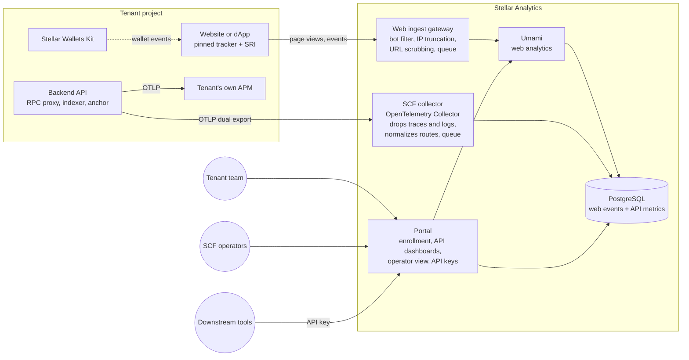
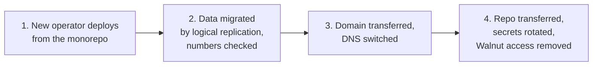

# Technical Architecture

Proposal-stage design for the SCF RFP [Web and API Analytics for Stellar Ecosystem Projects](https://stellar.gitbook.io/scf-handbook/scf-awards/build-award/rfp-track#current-open-rfps). Also published at [walnutlabs.notion.site](https://walnutlabs.notion.site/Public-Technical-Architecture-Document-for-Stellar-Analytics-41c3cefbe64b81d49ea9ffcedcad0935).

## Summary

Stellar Analytics is a free, multi-tenant web and API analytics service that SCF runs for every project building on Stellar, so reviewers get trusted usage data instead of self-reported numbers. It's built on [Umami](https://umami.is), MIT-licensed, in one monorepo with all infrastructure as code. Walnut hosts and supports it for 12 months after the final tranche and hands it over to a community operator between months 6 and 12.

## 1. Why Umami over GoatCounter

- **One database.** Umami runs on PostgreSQL, the store the RFP already requires for API metrics. One engine to back up, monitor and hand over.
- **Teams map to tenants**, so we extend Umami's access control instead of building our own.
- **Custom events with properties**, which Wallets Kit auto-capture needs. GoatCounter events have none.
- **MIT**, like our code. GoatCounter is EUPL.
- **Built-in bot filtering** and renamable tracker and endpoint, both needed against ad blockers.
- Tradeoff: heavier to run than GoatCounter's single Go binary, which matters little for a shared service.

## 2. Architecture



1. A project enrolls in the **portal** and gets a tracker snippet and an ingest key.
2. Its website loads the **tracker** and sends page views to the **gateway**, which filters bots, truncates IPs and strips identifiers from URLs. **Umami** stores the result in PostgreSQL.
3. Its backend sends OpenTelemetry to its own APM and to the **SCF collector**, which drops traces and logs and writes request counts and latency histograms to **PostgreSQL**.
4. Tenants see web stats in Umami and API stats in the portal. SCF operators use the global view. Tools read metrics with API keys.

Built with: TypeScript tracker based on Umami's, Go gateway, OpenTelemetry Collector built with the Collector Builder plus one Go exporter, Next.js portal, managed PostgreSQL.

## 3. Tenants and access control

- **Self-service**: any Stellar project signs in (GitHub or email), registers its sites and services, and gets its snippet and keys at once.
- **SCF control**: operators remove tenants (keys revoked at once, data deleted after 30 days) and can switch enrollment to approval-required.
- **Attribution from the credential**, never the payload. The collector overwrites any `tenant.id` the client sends.
- **Isolation**: one Umami team per tenant for web data, PostgreSQL row-level security for API data, and CI tests proving no page or endpoint shows another tenant's data.
- **Operator API keys**: read-only, stored hashed, revocable at once, every use logged. JSON or CSV.

## 4. Web analytics

One script tag, for static sites, SPAs and SSR frameworks (Next.js, Nuxt, Astro, SvelteKit):

```html
<script defer src="https://DOMAIN/v/1.0.0/s.js"
  integrity="sha384-..." crossorigin="anonymous"
  data-site="TENANT_SITE_ID"></script>
```

**Pinning and supply chain**

- Immutable, versioned URLs. Tenants upgrade by changing the version. No remote config or dynamic code.
- SRI hash in the snippet, so browsers refuse a modified file.
- No runtime dependencies, reproducible builds, signed releases from CI, npm provenance. Tenants can self-host the file.

**Ad blockers**: neutral names for script, endpoint and domain, tested in CI against EasyList, EasyPrivacy and uBlock Origin. The guide has first-party proxy recipes.

**Bots and inflation**, on top of Umami's user-agent filter:

- **Server-side posts**: an event counts only if the same visitor loaded the tracker shortly before, sends browser `Origin` and Fetch Metadata headers matching the tenant's domains, and carries a token from the tracker response.
- **Many fingerprints from one IP**: distinct user agents per truncated IP are counted in memory. Past a threshold that allows for NAT, events count as suspected inflation.
- Data-center traffic and `navigator.webdriver` are flagged, and the operator view flags spikes.
- Filtered traffic is shown with reasons, so SCF can audit it.

**Metrics**: page views, unique visitors, referrers, session duration, bounce rate, country, device and browser.

**Both nice-to-haves included**

- **Custom events** in one line, with scrubbed properties.
- **Wallets Kit auto-capture**, no tenant setup: wallet connected (wallet and network), signature requested, signed, rejected. Never addresses, XDR or amounts. If the kit lacks an event we need, we'll propose a hook upstream to Creit Tech.

## 5. API analytics

- **Dual export**: tenants add the SCF collector as a second OTLP exporter. The guide covers Node.js, Go, Rust, Python, existing collectors, and a reverse proxy in front of unmodified Horizon or Stellar RPC.
- **Kept**: the request-duration histogram with `service.name`, `http.route`, method and status code. For traces-only tenants, the histogram is derived from spans, then spans are dropped. Logs and all other attributes are dropped.
- **Retention**: 1-minute data 30 days, hourly 36 months, daily indefinitely. Histograms are stored as buckets, so p50 and p95 are exact over any range or group of tenants.
- **Sizing**: 1M requests a day is about 12 per second. SDKs pre-aggregate every 60 seconds, so even 20,000 active routes means about 330 points per second. Load-tested at 10×.

**Path normalization**: fixed rules, also applied to `http.route` as a safety net.

| Pattern | Becomes |
| --- | --- |
| Stellar account, muxed account, contract (G, M, C) | `{account}`, `{muxed}`, `{contract}` |
| Other StrKeys, assets (CODE:ISSUER) | `{strkey}`, `{asset}` |
| Secret seed (S…) | `{secret}`, and the tenant is alerted |
| Hashes, UUIDs, numeric IDs | `{hash}`, `{uuid}`, `{id}` |
| Emails, federation addresses, tokens | `{address}`, `{token}` |
| Query strings, trailing slashes | removed |

Example: `/accounts/GABC…XYZ/operations?limit=200` becomes `/accounts/{account}/operations`.

Stellar RPC is JSON-RPC on one URL, so the collector also keeps `rpc.method` for known Stellar RPC methods. A cap of 500 routes per service per day catches identifiers that slip through.

## 6. Dashboards

All for selectable time ranges:

- **Tenant web**: Umami, scoped to the tenant's team.
- **Tenant API**: volume, status codes, error rate, p50/p95 per route.
- **Global operator view**: all tenants with web and API metrics, filtering, sorting, side-by-side comparison, spike flags, CSV export.

## 7. Privacy and GDPR

- **No cookies, no browser storage, no stored IPs.** IPs are truncated in memory before the country lookup (local DB-IP Lite database) and before hashing.
- **Daily salt**: the visitor-hash salt rotates every 24 hours and never touches disk. After that, no one can link a hash to a person. Unique visitors are exact per day and approximate over longer ranges, which the RFP allows.
- **Scrubbing**: query strings are dropped by default. Paths, referrers and event properties go through the API route rules, so wallet addresses and emails in dApp URLs are never stored.
- **Legal basis**: legitimate interest for aggregate audience measurement, following the CNIL's consent-exemption criteria.
- **Data residency**: all data is stored in the EU, in AWS Frankfurt, with backups in a second EU region. The service itself is open to projects and visitors worldwide.
- **Opt-in may still be needed** in Germany under a strict reading of TDDDG §25, and in consent-first regimes such as China (PIPL) and South Korea (PIPA). Tenants there can enable a consent mode. A privacy lawyer reviews this list in Tranche #2.
- **Erasure**: by design almost no one can exercise it. For data a tenant sends by mistake, tenant admins erase by time range, URL pattern or event property in the portal.

## 8. Infrastructure, security and SLAs

- **Runs on** AWS eu-central-1, three zones, in a dedicated account: Kubernetes (EKS) via Helm, RDS PostgreSQL Multi-AZ, all in OpenTofu. The Helm chart runs on any cluster, and Docker Compose runs it on one machine.
- **99.99% ingestion**: the gateway and collector queue each event on disk before acknowledging it, so a database failover pauses writes, not ingestion. At least 3 replicas across zones.
- **Backups**: 35-day point-in-time recovery, daily snapshots in a second EU region, restores tested quarterly.
- **Monitoring**: Prometheus, Grafana and Alertmanager. External 1-minute probes (Gatus) outside AWS feed a public status page and monthly SLA reports.
- **Security**: secrets manager, least-privilege IAM, Renovate, image scanning, signed images, private vulnerability reports. Full STRIDE threat model and monitoring plan in Tranche #2.

We commit to at least the RFP's targets for 12 months, with support through public GitHub issues:

| Commitment | Target |
| --- | --- |
| Ingestion availability | 99.99% or better, monthly |
| Dashboard availability | 99.90% or better, monthly |
| Critical and high vulnerabilities | Patched within 24 hours |
| Support tickets | Answered within 5 business days, resolved within 10 |

## 9. Handover

From day one, the repo sits in a transferable GitHub org, the cloud in a dedicated AWS account and the domain in its own registrar account. Runbooks cover deploy, upgrade, failover, restore, secret rotation, erasure and incidents.



Tracker URLs and SRI hashes don't change, so tenants do nothing. If the domain stays with us, it redirects permanently (308 for ingestion). We remain available as backup until month 12.

## 10. Decentralization and open source

- **Centralized by design**: the RFP asks for one service SCF trusts. **Not on-chain**: usage data is private and high-volume.
- **Trust through openness**: code, infrastructure, metric definitions and filter rules are public, and anyone can run the stack.
- **MIT**, OSI-licensed dependencies only (OpenTofu, not Terraform), one monorepo built in the open: [github.com/walnuthq/stellar-analytics](https://github.com/walnuthq/stellar-analytics). Latest stable Stellar releases (Wallets Kit, JS SDK, stellar-base StrKeys).
- **Updates** in the SCF GitHub discussion and Stellar Dev Discord at each tranche and monthly during hosting.
- **Possible follow-on**: anchor a monthly hash of published aggregates on Stellar, so SCF usage reports are tamper-evident.

## 11. Milestones

| Tranche | Deliverables |
| --- | --- |
| #1 | Web analytics on staging: tracker, gateway, Umami, self-service enrollment, isolation tests, infrastructure as code |
| #2 | API analytics, operator view and API keys, Wallets Kit auto-capture and custom events, threat model, monitoring plan, privacy docs |
| #3 | Production launch with at least 3 SCF projects on web and 1 on API, runbooks, onboarding guide, handover plan, then 12 months of hosting and support |
